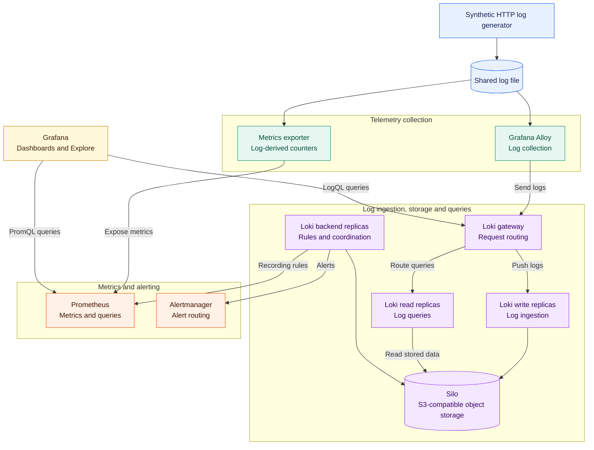

# Distributed Log Observability Lab

A local, containerized observability lab for exploring how synthetic HTTP logs become searchable events, operational metrics, and alerts. It combines Grafana, Loki, Prometheus, Alloy, Silo and Alertmanager in a reproducible Docker Compose environment.

# Click and [▶ Watch the demo video](https://youtu.be/4W-wq4l-nQs)


## Core Technologies

### Grafana
Grafana is a visualization and analysis platform. In this project, it
connects to Prometheus and Loki so you can explore metrics and logs through
dashboards and queries.
### Prometheus
Prometheus is a monitoring system and time-series database. It collects
numerical metrics at regular intervals and makes them available for querying.
In this project, it collects metrics such as HTTP request counts and response
sizes from the synthetic log exporter.
### Grafana Loki
Loki is a log aggregation system. It stores and indexes labels associated
with log streams, making it possible to search and analyze logs using LogQL.
In this project, Loki receives synthetic HTTP logs collected by Grafana Alloy.

### How they work together
1. A generator creates synthetic HTTP logs.
2. Grafana Alloy collects the logs and sends them to Loki.
3. A separate exporter reads the logs and exposes numerical metrics to
   Prometheus.
4. Grafana queries Loki and Prometheus to display logs and metrics.
> **Scope:** This is a teaching and demonstration environment. It does not contain a banking application, real transaction data, attack detection rules, or production-ready security controls. Synthetic traffic and its response codes are not evidence of a cyberattack.

## What you can demonstrate

- Follow synthetic JSON HTTP logs from generation through collection and Loki ingestion to Grafana Explore.
- Compare raw log events with request rates and response sizes derived by a small Prometheus exporter.
- Inspect a Loki recording rule and a missing-log alert, and discuss the difference between telemetry gaps and security incidents.
- Examine a multi-process Loki topology and its object-storage dependency in one local environment.

## Architecture

The lab uses two complementary telemetry paths: **logs** are collected by
Grafana Alloy and sent to Loki, while **metrics** are generated from the
same synthetic log file and scraped by Prometheus. Grafana brings both
sources together for investigation and visualization.



**Investigation flow:** Start with a metric in Grafana, then explore the
corresponding synthetic logs in Loki. The missing-log rule illustrates
how a telemetry gap can be sent to Alertmanager.

> This is a single-host lab. The replicas demonstrate Loki's component
> topology; they do not provide host-level high availability.

Loki also uses memberlist for cluster coordination. Grafana queries Loki through the gateway. The exporter reads the same file independently; it does not derive Prometheus metrics from Loki. All traffic is synthetic. The exporter counts parsed lines and response bytes, not request latency. Counters reset on exporter restart, and the file reader may replay data on restart or rotation; do not use these values for billing or audit evidence.

## Prerequisites

- Docker Engine and Docker Compose v2, with the daemon running and enough resources for multiple Loki replicas.
- Internet access to pull the pinned container images and build the exporter.
- Available local ports: 3000, 8080, 8082, 9000, 9001, 9090 and 9093.
- A local shell. Commands below use Docker Compose; the copy command shown is for PowerShell.

## Quick start

1. Copy the example environment file and set a unique local Grafana password:

   ```powershell
   Copy-Item .env.example .env
   # Edit .env and replace the example password before starting.
   ```

   On macOS/Linux: `cp .env.example .env`. Never commit `.env`. Grafana applies the initial admin password when its data volume is first created; changing `.env` later does not automatically reset an existing account.

2. From the project root, start the lab:

   ```sh
   docker compose config --quiet
   docker compose up -d --build
   docker compose ps
   ```

   Initial image downloads and cluster startup may take several minutes. Compose start order does not guarantee readiness.

3. Open [Grafana](http://localhost:3000), sign in as `admin` with the password in `.env`, and open **Dashboards → Observability Lab → Synthetic HTTP Observability**. Allow several minutes for rate queries to populate. Adjust the dashboard time range if needed.

4. In **Explore**, select the `loki` data source and run:

   ```logql
   {job="generated-logs"} | json
   ```

   Try `sum by (http_status) (rate({job="generated-logs"}[1m]))` to compare log-derived rates by status. In [Prometheus](http://localhost:9090), inspect `up` and `sum by (method) (rate(http_requests_total[5m]))`. Check [Alertmanager](http://localhost:9093) for alerts; the configured receiver has no external notification integration.

5. Stop the containers with `docker compose down`. Named volumes and the `.data` and `loki` directories remain. To reset local data, `docker compose down -v` removes this project's named volumes; separately remove the generated `.data` and `loki` directories only when you no longer need their contents.

## Endpoints

| Service | Local address | Purpose |
| --- | --- | --- |
| Grafana | http://localhost:3000 | Dashboards and log exploration |
| Prometheus | http://localhost:9090 | Metrics queries and target status |
| Loki gateway | http://localhost:8080 | Loki HTTP gateway |
| Exporter | http://localhost:8082/metrics | Metrics derived from synthetic logs |
| Alertmanager | http://localhost:9093 | Alert grouping and routing |
| Silo console | http://localhost:9001 | Local object-storage console |

Published ports bind to loopback. Silo uses the demo credentials `loki` / `supersecret` in the configuration; these are public example credentials, not secrets. The Grafana dashboard and data sources are provisioned at startup. Grafana edits to a provisioned dashboard are not a substitute for updating the checked-in JSON.

## Alert demonstration

The Loki rule `NoGeneratedLogs` evaluates a five-minute absence window and requires two additional minutes in the pending state. To demonstrate a telemetry gap, run `docker compose stop log-generator`, wait at least seven minutes plus evaluation and delivery time, and inspect Loki ruler/Alertmanager state. Restore traffic with `docker compose start log-generator` and observe recovery. This rule detects absence of the entire labeled stream; it does not identify the cause, establish a compromise, or guarantee notification. The default Alertmanager receiver discards notifications until a receiver is configured. The environment and end-to-end delivery should be verified on your own machine before presenting.

## Security and research boundaries

- Local-only port bindings reduce exposure but do not provide network isolation from other containers or users on the host. The Loki gateway and Prometheus remote-write receiver do not authenticate clients; Loki tenant headers are not authentication.
- Internal traffic and object storage use HTTP. Demo object-store credentials are committed. There is no TLS, secret management, access policy, audit trail, backup, or tested recovery plan.
- This is a single-host lab, not high availability: replicas share one host and Silo instance. Loki write-ahead logs are not configured for durable recovery; Alloy positions are stored in a named volume, but end-to-end recovery is not guaranteed. The generator and exporter share a host directory; verify its permissions on your platform.
- Review version support, image provenance and vulnerabilities before any real deployment.
- Treat logs as sensitive: minimize and redact personal data, tokens and account identifiers; define access control and retention before ingesting real events. No retention or deletion guarantee is claimed here.
- A stronger research evaluation would define a threat model, baseline, representative labeled dataset, attack scenarios, detection hypotheses and measurable results (precision, recall, alert delay and operational cost). Record assumptions, limitations and reproducible procedures; do not claim detection efficacy without evidence.

## Troubleshooting

- **No dashboard data:** wait for traffic and rate windows, check the time range, then inspect `docker compose ps` and `docker compose logs --tail=100 log-generator alloy metrics-exporter`.
- **Loki query fails:** inspect `docker compose logs --tail=100 loki-gateway loki-read loki-write loki-backend minio` and confirm all replicas have started. The provisioned Loki data source sends tenant ID `docker`.
- **Prometheus target down:** check **Status → Targets** and exporter logs. The exporter exposes `log_exporter_invalid_lines_total` for malformed lines.
- **Cannot sign in after changing the password:** the Grafana named volume preserves its database. Use Grafana's supported password reset procedure or reset the lab data only if it is safe to discard.
- **Port conflict or resource pressure:** stop the conflicting process or change the loopback port mappings; allocate sufficient Docker memory and CPU. This topology has several containers.

## Project layout

```text
config/                  service configuration, Alloy and Grafana provisioning
rules/docker/            Loki recording and alerting rules for tenant docker
scripts/                 synthetic-log-to-metrics exporter
compose file             container topology
grafana-dashboard.json   provisioned Grafana dashboard
DEMO.md                  presentation and recording guide
```

## Demo and next steps

See [DEMO.md](DEMO.md) for a presentation storyboard, verification checklist, and research-oriented discussion prompts. Add your own hosted demo link or video thumbnail here after recording; do not commit credentials, private logs, or recordings containing sensitive information.

## Publish to GitHub

Create an empty repository first. From this project directory, run:

```sh
git init
git add .
git status
git commit -m "Add observability lab"
git branch -M main
git remote add origin https://github.com/riad67/prometheus-loki-grafana-docker-combo.git
git push -u origin main
```

Check `git status` before committing: `.env`, generated logs and local storage must remain untracked. If `origin` already exists, use `git remote set-url origin https://github.com/riad67/prometheus-loki-grafana-docker-combo.git` instead of `git remote add`. If the remote already has commits, inspect and integrate them before pushing; do not force-push.
